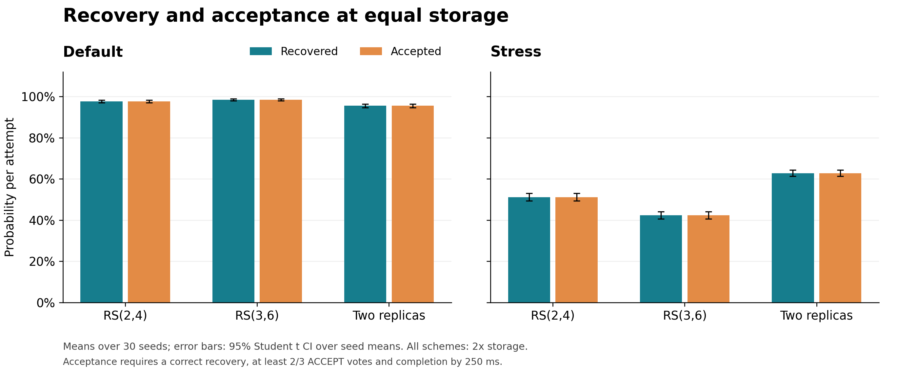
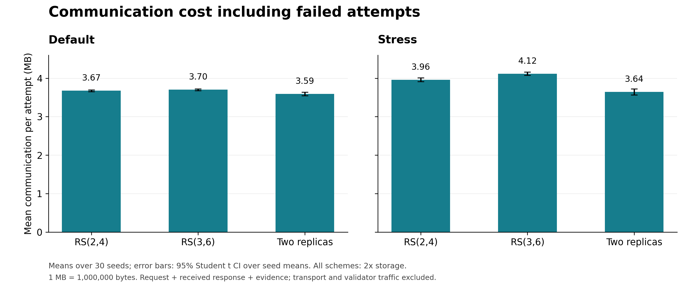

# Member 3 Experiments and Evaluation

## Deliverable

The evaluation compares RS(2,4), RS(3,6) and two full replicas under default and stress conditions. All six configurations use the same frozen BTC/ETH signal bundle and exactly twice its transport-envelope size in storage. The experiment runner performs actual reconstruction and three independent validator checks. It does not replace retrieval with analytical success probabilities.

The formal design is 30 seeds (0 through 29), 100 rounds per seed and six configurations: 18,000 attempts. Member 2's published records are retained unchanged. Member 3 runs the complete matrix independently, audits the result and compares every published field except the new execution's run_id. All non-time fields match exactly. Completion times use an explicit absolute tolerance of 1e-12 ms: Windows/macOS math-library rounding differs in 73 records, by at most 2.842170943040401e-14 ms. Outcomes, votes, hashes and byte counts are identical. The statistical unit is the seed.

## Configuration and fairness

| Environment | Silent probability | Invalid probability | Honest probability | Latency median |
|---|---:|---:|---:|---:|
| Default | 0.10 | 0.10 | 0.80 | 50 ms |
| Stress | 0.30 | 0.30 | 0.40 | 100 ms |

Silent, invalid and honest states are mutually exclusive. Latencies are lognormal with sigma 0.5; the deadline is 250 ms and the simulated parallel validator budget is 1 ms. These timing constants are implementation assumptions, not measured network or Sepolia performance. The environments, seeds, deadline and accounting rules are shared across schemes. Node random streams overlap across schemes where node indices overlap; the comparison therefore preserves the existing paired randomization.

RS uses four or six nodes, while replication uses two nodes. Equal storage is not equal node count. The common deterministic, uncompressed ZIP envelope is 3,306,606 bytes, padded to a multiple of six. Each scheme stores 6,613,212 bytes. Fragment metadata is excluded from the 2x payload-storage ratio and included in communication accounting.

All nodes are requested in parallel at time zero. Collection stops at the kth valid arrival or the deadline. Invalid responses arriving before stopping consume communication bytes. Later arrivals are canceled and excluded under this model. No attempt is retried. Both successful and failed attempts enter the denominators.

## Metrics and uncertainty

For each configuration and seed, aggregate its 100 rounds:

- Recovery probability: correctly reconstructed and anchored objects divided by all attempts. Reconstruction must occur within the retrieval deadline.
- Acceptance probability: correct recovery, at least two ACCEPT votes and completion including the validator budget by the deadline, divided by all attempts.
- Communication bytes: mean request JSON bytes plus received fragment bytes plus response-evidence JSON bytes per attempt, including failures.
- Corrupted data acceptance count: independently checked accepted objects whose returned bytes do not match the expected envelope. This count must be zero.

For each metric, compute the mean of the 30 seed means. The two-sided 95% interval is `mean +/- t(0.975,29) * sample_sd(seed_means) / sqrt(30)`, with critical value 2.045229642132703. The 3-seed smoke and pilot use t(0.975,2) = 4.302652729696142. Do not treat 3,000 individual rounds as independent statistical samples. Intervals are untruncated descriptive marginal intervals; no multiple-comparison significance claim is made.

Completion time is auxiliary: compute each seed's mean only over its recovered rounds, then average those seed means. Unavailable times are never filled with zero. All 30 seeds in every formal configuration have recovered observations. Simulated completion milliseconds exclude actual decoding, disk, Python execution and blockchain-query time.

## Results

Each row contains 30 seed means from 3,000 attempts. Recovery and acceptance coincide in this particular formal sample; they remain separate metrics and are tested at the deadline boundary.

| Environment | Scheme | Recovery / acceptance, % [95% CI] | Communication, MB [95% CI] | Conditional completion, ms [95% CI] |
|---|---|---:|---:|---:|
| Default | RS(2,4) | 97.67 [97.00, 98.33] | 3.673 [3.649, 3.697] | 53.22 [52.54, 53.89] |
| Default | RS(3,6) | 98.47 [97.99, 98.94] | 3.700 [3.675, 3.724] | 55.84 [55.09, 56.58] |
| Default | Two replicas | 95.50 [94.57, 96.43] | 3.589 [3.543, 3.635] | 47.18 [46.27, 48.09] |
| Stress | RS(2,4) | 51.17 [49.35, 52.98] | 3.960 [3.913, 4.008] | 121.95 [119.03, 124.87] |
| Stress | RS(3,6) | 42.37 [40.65, 44.08] | 4.116 [4.074, 4.159] | 136.31 [133.77, 138.84] |
| Stress | Two replicas | 62.77 [61.27, 64.26] | 3.641 [3.563, 3.719] | 101.22 [99.16, 103.29] |

Here 1 MB is 1,000,000 bytes. Exact, unrounded values are in `artifacts/part3/analysis/summary.csv`. Per-seed evidence is in `seed_metrics.csv`; original round records are in `artifacts/part3/formal/rounds.csv`.

Figure 1 answers RQ1: increasing unavailable/corrupt-node probabilities sharply reduces both recovery and acceptance. RS(3,6) has the highest observed default recovery, but is least available under stress. Its small default advantage over RS(2,4) should not be treated as an established ranking from marginal CIs alone.

Figure 2 answers RQ2: under default conditions the RS schemes have higher observed recovery than replication, accompanied by higher mean communication. Under stress, replication achieves both higher observed recovery and lower communication in this model. Equal storage does not imply that RS is better on all other metrics.

## Explaining the stress result

In stress conditions only 40% of nodes are honest before considering late arrivals. Replication needs one of two full objects. RS(2,4) needs two of four distinct valid fragments, and RS(3,6) needs three of six. The higher threshold can outweigh spreading redundancy across more nodes. As a sanity reference without deadlines, independent honest-node probability 0.4 gives availability 0.6400 for replication, 0.5248 for RS(2,4), and 0.45568 for RS(3,6). These are analytical references, not replacements for the measured simulation rounds. Late arrivals reduce effective availability further.

This is the required Member 3 failure case: a lower-than-expected RS recovery rate is explained by the explicitly configured honest probability, threshold and deadline, rather than by removing unfavorable seeds or redefining success.

## Audit and reproducibility

The audit checks unique round identities; complete seed/round coverage; k/n; exactly 2x storage; fragment counts; payload and manifest hashes; three actual votes; recovery/acceptance implications; deadline rules; communication sums; and zero independent corrupted acceptances. It rejects missing/duplicate records and inconsistent values. Published CSV, seed totals and configuration totals are cross-checked when analyzing the Member 2 evidence directly.

`evaluation.run` supports smoke (36 attempts), pilot (540 attempts) and formal (18,000 attempts) profiles. Every profile uses the real bundle and the Part 2 API, with network connections blocked. `evaluation.smoke` copies only the necessary source and frozen input files to a new directory, runs execution and analysis twice with no Git, model, wallet or third-party statistical packages, compares deterministic output bytes, and checks the 36 replayed records against the published formal dataset.

Two cross-platform issues were resolved without changing any frozen evidence: `.gitattributes` preserves literal artifact/deployment bytes and uses LF for source files; `ZipInfo.create_system` is fixed to 3 to preserve the Unix envelope used in the original experiment. A regression test covers Windows and Unix ZIP creator defaults. ObjectId, all six bundle files and all on-chain fingerprints remain unchanged.

Use `docs/part3-reproduction.md` for exact commands. Outputs refuse non-empty destinations. Checksums, source fingerprints, Python version and configuration accompany the results. Figure generation reads audited CSV only and does not rerun experiments.

## Limits and claims

The evidence supports version integrity for the fixed bundle (RQ3) and a reliability/communication tradeoff under the stated simulation model (RQ1/RQ2). A zero corruption count means no incorrect object was accepted in these tested attempts; it is not a guarantee against every attack.

Assumptions include independent categorical node states, independent lognormal delays, a trusted fragment catalog, an authentic offline Sepolia snapshot, and three honest online validators. There is no bandwidth bottleneck, correlated outage, malicious-validator experiment, Sybil model, full BFT, incentive system or complete Proof of Retrievability. The communication metric omits TCP/TLS, registry queries, validator messages and storage/CPU work. Retrieval deadlines are shared; real chain performance is not benchmarked. Model inference and strategy profitability are outside this evaluation.
