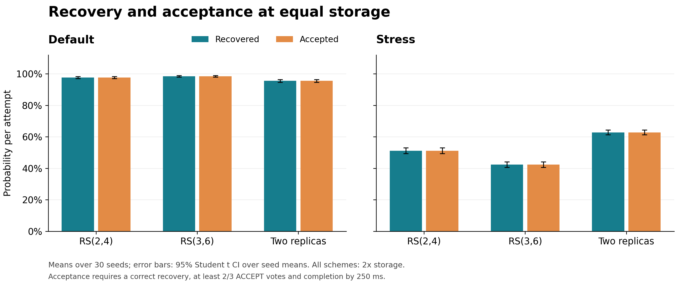
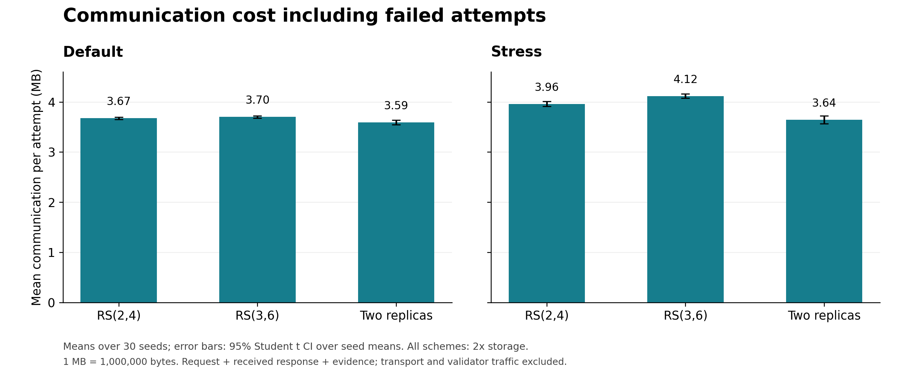

# Verifiable BTC and ETH Signal Retrieval

## Abstract

We implement a small verifiable data-retrieval prototype combining a fixed quantitative signal bundle, public version registration on Sepolia, and Reed-Solomon (RS) erasure-coded retrieval. A pinned open-source checkpoint generates buy/hold/sell signals from fixed BTC/ETH history. The bundle's data, model, signal and manifest fingerprints are registered on-chain. Local retrieval verifies fragments, actually reconstructs the object and checks the registered fingerprints before applying a two-of-three rule with honest validators. At equal 2x storage, we compare RS(2,4), RS(3,6) and two full replicas in six simulation configurations, using 30 seeds and 100 attempts per seed. RS achieves higher observed recovery than replication under default faults, while replication has higher recovery and lower communication under stress. No incorrect object is accepted in the 18,000 attempts. These results concern the stated simulation assumptions, not production consensus, source truth or trading profitability.

## 1 Research questions and system scope

RQ1 asks how node silence, invalid responses and delays affect recovery and acceptance before a deadline. RQ2 asks how RS and two complete replicas trade recovery against communication at the same storage overhead. RQ3 asks whether a real BTC/ETH signal bundle can be publicly anchored, retrieved, recovered and traced to its original record.

The implementation has three layers. The application creates one reproducible bundle. A public registry anchors its version fingerprints. The retrieval simulator distributes encoded fragments or full replicas and checks recovered content. There is no new blockchain consensus protocol, data marketplace, token, training pipeline or real-money execution.

## 2 Application and canonical bundle

The application uses Binance Spot BTCUSDT and ETHUSDT hourly candles from 1 January 2024 to 1 January 2025 UTC. July-September is validation; October-December is test. Raw monthly responses are cached, duplicate conflicts and missing hours are rejected, and dataset bytes are hashed.

The model is `amazon/chronos-t5-small` at revision `a971ba21945c4f1796b17a91fe69214b5f4ad472`, with context 64 and prediction length one. Inference uses CPU float32 and the median of 20 samples. The threshold is the validation median absolute predicted return, rounded half-even to 12 decimal places and frozen at 0.001923089035. Returns above the positive threshold produce buy; below the negative threshold produce sell; other values, including equality, produce hold. Test data does not select the threshold.

The auxiliary long-only backtest executes a signal at the next target bar's open and settles at its close. Buy targets position one, sell targets zero, and hold carries the previous position. A 10-basis-point cost is charged on position changes; validation and test begin flat independently. Backtest performance is not evidence of real trading profitability.

The bundle contains `dataset.csv`, `signals.csv`, `backtest_summary.json`, `config.json`, `model_reference.json` and `manifest.json`. Canonical JSON uses UTF-8, sorted keys, compact separators and one trailing LF. The sorted five content-file entries contain path, size and SHA256. Their canonical serialization determines the payload commitment. The manifest identity view removes only object_id before deriving objectId; the final manifest bytes determine manifestHash. This avoids self-referential hashing. A standalone verifier recomputes file hashes, identities and commitments without importing the generator.

## 3 On-chain provenance

`SignalRegistry` stores provider, dataHash, modelHash, signalHash, manifestHash and timestamp. `registerSignal` is write-once for an objectId and emits an event; `getSignal` returns the immutable record. Provider is msg.sender. There is no owner, upgrade hook or fund handling. CSV files, model weights and inference remain off-chain.

The frozen deployment is on Sepolia (chainId 11155111):

- Contract: `0x7BA4b62c97Ce9567075736f7cffAEFafAC8C4E41`.
- ObjectId: `0x1143b163d9a56e29e5714b7cd7ca41c6d05353ceb903704316219060915a4d07`.
- ManifestHash: `0x3f3fa32d9c98ba929c9e002f0d9e6c35ec46b42a36344c64bdb8426257870ca6`.
- Registration transaction: `0x742eecdd2cffcbd74fe32b61ec0ee3fff48c29d4163d998afe86af8bff5c5e51`, block 12132049.

The [contract](https://sepolia.etherscan.io/address/0x7BA4b62c97Ce9567075736f7cffAEFafAC8C4E41) and [registration transaction](https://sepolia.etherscan.io/tx/0x742eecdd2cffcbd74fe32b61ec0ee3fff48c29d4163d998afe86af8bff5c5e51) are public references. Historical receipt/event and local-record checks are retained in the repository. Offline experiments use the saved registry snapshot rather than performing RPC queries. Authenticating a newly supplied snapshot requires separate chain verification. A fingerprint proves version consistency with a registration; it does not prove an honest source, correct model or profitable strategy.

## 4 Retrieval and verification

The six original files are packed in a deterministic uncompressed ZIP with fixed timestamps, ordering, permissions and Unix creator platform. Padding makes the envelope length divisible by six. The envelope is 3,306,606 bytes and each scheme stores 6,613,212 bytes. The envelope digest is distinct from manifestHash.

The systematic RS codec uses GF(256), polynomial 0x11d and a normalized Vandermonde generator. Any k distinct valid fragments reconstruct the object. Corruption is filtered through expected SHA256 before erasure decoding; this is not correction of unknown malicious errors. The baseline stores two full envelopes and needs one correct replica.

Each node is honest, silent or invalid. Requests fan out once to all nodes. Responses must match objectId, assigned index, unique index, size and expected fragment hash. Invalid/duplicate responses consume bytes but do not advance the threshold. Collection stops at the kth valid response or the deadline. Reconstructed bytes are checked against the expected envelope digest, six-file structure, content hashes, payload commitment, objectId and recorded manifestHash. Each of three honest validators independently repeats the bundle/anchor check. Acceptance needs at least two ACCEPT votes and timely completion.

Tests cover all 26 minimum-threshold real-bundle subsets, insufficient/duplicate indices, corrupt data, wrong object/index, forged fragment catalogs, deadlines and the two-of-three rule. Part 2 additionally retains exhaustive checks of 819 categorical node-state assignments. The successful offline demo deliberately silences node zero and corrupts node one's response, then reconstructs from indices 2, 3 and 4 and traces the first BTC signal at 2024-07-01 00:00 UTC. The displayed 61 ms is simulated completion, not CLI or chain latency.

## 5 Experimental design

| Environment | Silent | Invalid | Honest | Lognormal latency median |
|---|---:|---:|---:|---:|
| Default | 0.1 | 0.1 | 0.8 | 50 ms |
| Stress | 0.3 | 0.3 | 0.4 | 100 ms |

Both environments use latency sigma 0.5, deadline 250 ms and a 1 ms simulated parallel validator budget. Silence and invalidity are mutually exclusive. The three schemes share the frozen payload, seed set, fault probabilities, latency model and deadline. Overlapping node indices use the same seed/round random streams. Storage overhead is exactly 2x; node counts and metadata overhead differ.

The formal matrix contains six configurations x 30 seeds x 100 attempts = 18,000 attempts. Recovery probability counts correctly reconstructed anchored objects within the retrieval deadline. Acceptance additionally requires two votes and validation completion before the deadline. Communication is the sum of request JSON, received response-body and response-evidence bytes per attempt, including failures. Responses after collection stops are excluded by the cancellation assumption. Transport overhead, registry queries, validator traffic and disk/CPU work are excluded.

We compute metrics within each seed, then form a mean and 95% Student t interval across the 30 seed means (29 degrees of freedom). Rounds within a seed are not treated as independent samples. Intervals are descriptive and untruncated; there is no multiple-comparison hypothesis-testing claim. Conditional completion time is auxiliary and never imputes failed attempts as zero.

## 6 Results

| Environment | Scheme | Recovery and acceptance, % [95% CI] | Mean communication, MB [95% CI] |
|---|---|---:|---:|
| Default | RS(2,4) | 97.67 [97.00, 98.33] | 3.673 [3.649, 3.697] |
| Default | RS(3,6) | 98.47 [97.99, 98.94] | 3.700 [3.675, 3.724] |
| Default | Two replicas | 95.50 [94.57, 96.43] | 3.589 [3.543, 3.635] |
| Stress | RS(2,4) | 51.17 [49.35, 52.98] | 3.960 [3.913, 4.008] |
| Stress | RS(3,6) | 42.37 [40.65, 44.08] | 4.116 [4.074, 4.159] |
| Stress | Two replicas | 62.77 [61.27, 64.26] | 3.641 [3.563, 3.719] |

1 MB = 1,000,000 bytes. Recovery and acceptance happen to coincide in this sample; deadline-boundary tests show that a successful reconstruction can still be rejected after its validation budget. Corrupted data acceptance count is zero across the 18,000 attempts.

Figure 1 addresses RQ1. Availability declines sharply under stress. RS(3,6) has the highest observed default recovery and the lowest stress recovery; its small default difference from RS(2,4) is not a significance claim based on marginal intervals.

Figure 2 addresses RQ2. In default conditions the RS schemes achieve higher observed recovery with higher communication. Under stress, replication has both higher observed recovery and lower communication than either RS scheme. With only 40% honest nodes before considering delay, the requirement for three distinct valid fragments is harder to satisfy than the requirement for one complete replica. This explains the lower-than-expected RS stress result without removing unfavorable observations.

RQ3 is supported by the existing public registration and offline demo: the real six-file bundle is actually reconstructed, its fingerprints agree with the saved registered version, and the signal remains traceable to its data/model references.

## 7 Reproducibility and limitations

The independent Member 3 formal run, audit, seed statistics, CSV-derived PNG/SVG figures, complete-record comparison and clean-directory smoke are indexed in `artifacts/part3`. Existing Member 1/2 evidence is retained unchanged. Source/input checksums and Python 3.12.14 accompany the results. The standalone reproduction package contains the necessary source, frozen inputs, tests and English materials, without keys or model caches. See `docs/part3-reproduction.md` for commands.

The simulation assumes independent node faults and delays, trusted fragment metadata, an authentic offline registration snapshot, and three honest online validators. There is no correlated outage, bandwidth bottleneck, malicious-validator analysis, Sybil resistance, economic incentive system, full BFT or complete Proof of Retrievability. Simulated latency and logical bytes are not real blockchain/network measurements. The fixed signal bundle is an application example, not evidence of predictive skill or trading profit.

We conclude that this prototype makes a real signal version traceable and its retrieved bytes verifiable. At fixed storage, retrieval reliability depends on the recovery threshold, failure distribution, deadline and communication model; RS is not universally preferable to full replication.

## Repository evidence

Application and registry: `src/signal_pipeline/`, `contracts/SignalRegistry.sol`, `deployments/sepolia.json`. Retrieval: `retrieval/` and `report/02-member2-retrieval.md`. Evaluation methods and exact values: `report/04-member3-evaluation.md`, `configs/evaluation.json`, `artifacts/part3/analysis/summary.csv`. The two figures and their underlying seed/round CSVs are reproducible through the documented CLI commands.
